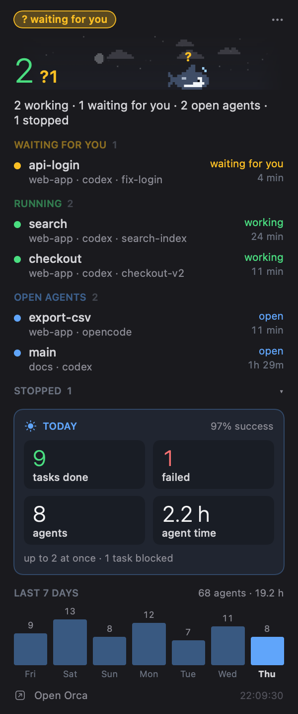

# Orcy

A second app in this package: what runs in [Orca](https://github.com/stablyai/orca) (the agent orchestrator), in the menu bar.
A pixel orca shows how many agents work (▶) and how many wait for you (?, blinking). The panel lists the worktrees as
**Waiting for you**, **Running**, **Open agents** (an agent open and idle, like a `claude` or a `codex` waiting for work)
and **Stopped**, with repo, agent and for how long, then today (tasks done and failed, agents, agent time) and the last
7 days. Worktrees Orca hides (the ones it did not create) show too.

<p align="center">
  
  
</p>

Pictures use made-up data (`ORCY_DEMO=1`).

It shares the mascot brain, the pet format, the sky and the formatting with Codexy (`CodexyCore`); `OrcyCore` holds only
the Orca readers. The UI target is a trimmed copy of `CodexyUsage` (see "Toward one package" below).

## Build

```sh
./scripts/bundle-orcy.sh        # ~/Applications/Orcy.app
./scripts/make-icon-orcy.sh     # Resources/Orcy/AppIcon.icns from the orca drawing
S=$HOME/Library/Caches/codexy-build
$S/debug/Orcy --snapshot DIR    # panel.png + bar.png with live data; ORCY_DEMO=1 for made-up data
```

On a Mac with only the Command Line Tools and the macOS 27 SDK, SwiftUI's `@State` needs a macro plugin that ships with
Xcode only: build with `SDKROOT=/Library/Developer/CommandLineTools/SDKs/MacOSX26.5.sdk`.

## Where the numbers come from (read-only, checked on Orca 1.4.223)

| What | Source | When |
|---|---|---|
| Worktrees and each agent's state | `orca worktree ps --json`, the CLI inside Orca.app (~0.13 s CPU a call) | every 10 s (30 s when all is quiet), only while Orca runs |
| Terminals, the agent in each (`agentIdentity`: codex, claude, opencode…), the worktrees Orca hides | `orca terminal list --json` | with the read above |
| opencode working in a folder (optional) | `~/.local/share/opencode/opencode.db`, read-only, one query (~1 ms); nothing without opencode | with the read above |
| Agents started, agent time, most at once | `~/Library/Application Support/orca/orca-stats.json` (`agent_start` / `agent_stop`) | every minute |
| Tasks done, failed, blocked; questions | `~/Library/Application Support/orca/orchestration.db` (SQLite, read-only; dates in UTC) | every minute |

Orca's agent states (from its own code: working, monitoring, waiting, blocked, done, idle, unverifiable) fold into
working (working, monitoring) and waiting for you (waiting, blocked). A worktree is, most urgent first: waiting, working
(an agent working; or terminal output in the last 90 s with no agent state; or an opencode session running in its
folder), open agent (an agent is named or finished its turn, nothing to do), stopped (terminals only, or none).

Orca hides the worktrees it did not create (a repo's external worktree visibility, `hide` by default), and `worktree ps`
leaves them out together with their agents. Their terminals are in `terminal list`, which Orcy uses to bring them back.
`worktreeId` is `<repo id>::<path>`: the repo's name comes from the rows `worktree ps` gave for the same repo id. The
rows show the repo when there is more than one, so two worktrees called `main` can be told apart.

An opencode in an Orca terminal prints little, so its terminal looks quiet while it works: when opencode's database has
a session with no idle time, updated in the last 5 minutes, in the worktree's folder, the worktree counts as working.

The same answers carry prompts, agent messages, tool input and terminal previews: Orcy never parses them into its model,
never stores or shows them. It never sends Orca a command and never starts it (the CLI is called only while Orca runs).

Cost measured: a read starts the CLI twice (~0.3 s of CPU), so it runs every 10 s while something works or waits or the
panel is open, and every 30 s when all is quiet; opening the panel reads at once. Quiet: ~0.8 s of CPU a minute in all
(the app and the CLI), busy: ~1.9; ~28 MB. The orca animates only while the panel is on screen (`WindowVisibility`):
the menu bar keeps the panel view alive while closed.

Data: `~/Library/Application Support/Orcy`, log `~/Library/Logs/Orcy.log`, bundle id `dev.julio.orcy`.

## Toward one package

Claudy, Codexy and Orcy share most of their code. A proposal, step by step:
1. **This PR**: Orcy lives here and reuses `CodexyCore` (mascot, pets, sky, format).
2. Move the shared UI (themes, prefs, settings window, scene, alerts, strings helper) into a library target, e.g.
   `MascotKit`, so each app keeps only its model, panel and strings.
3. Bring Claudy in as a third app on the same core, and rename the package (e.g. `usage-pets`).
4. One release workflow that builds the three apps.
